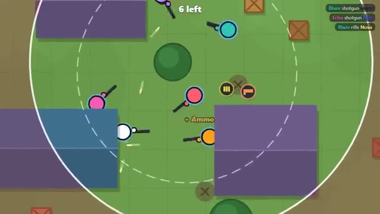

# Last Circle

Land, loot, outrun the circle. Last one standing wins. A multiplayer starter game from [Multiplayer Agent](https://multiplayeragent.com): 2D, versus, 2–24 players, with bots that fill the match to about 16 fighters.

## How it plays

Drop onto the island, grab guns, armor and medkits from houses and crates, and stay inside the circle as it shrinks. Get knocked out and you watch the one who got you until the next match.

**Controls:** WASD and mouse, 1–4 weapons, R reload, H medkit; or two thumb sticks and on-screen buttons.

## Make it yours in the Game Builder

Open the [Game Builder](https://multiplayeragent.com), choose **Start from a starter game** and pick Last Circle. It opens as version 1 in your studio, ready to play and publish. Then ask for changes, for example:

- Add a sniper rifle that only turns up in crates
- Make it a snowy island with frozen lakes
- Add grenades you can throw over walls

## Run it yourself

1. Get a free publishable key (`pk_…`) at [multiplayeragent.com](https://multiplayeragent.com).
2. In `index.html`, put it in place of `pk_REPLACE_ME` in the `MP_CONNECT` block.
3. Open `index.html` in a browser. No build step and no server needed.

Without a key it still runs, offline against bots.

## How it is built

- One `index.html`. The comment at the top of the script maps the code and explains the multiplayer.
- **Leaderboard:** Each player's most kills in one match, shown on the results card.
- **Host-run rounds:** The host's browser shrinks the circle on a timestamp schedule, hands out loot to the first claim, breaks crates, ranks who's out and starts the next match; if it leaves, the next player takes over.
- **Bots:** Bots fill the match to about 16 fighters. They loot, fight, heal and run from the circle.
- **Live sync:** Every player, bullet, pickup and crate shows up for everyone at once.
- Every match is a new island, built from a seed the host shares, so every screen builds the same one.
- `?attract` runs it offline with bots only. The preview video is recorded from it.

## License

MIT.
